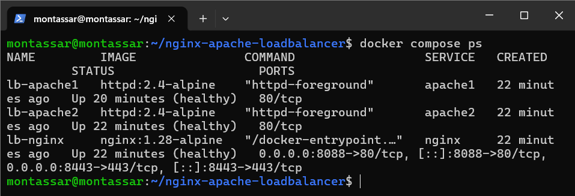
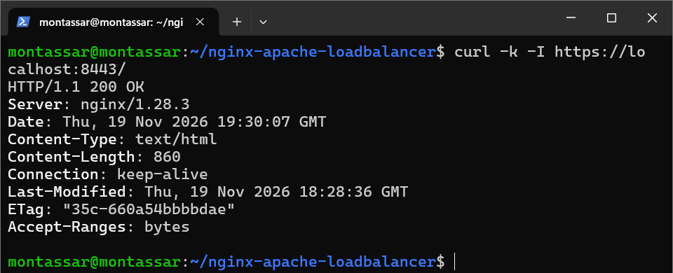
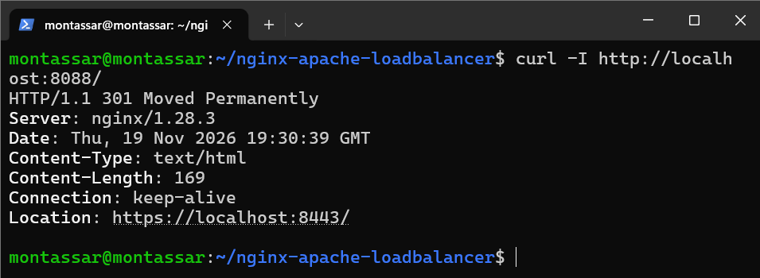
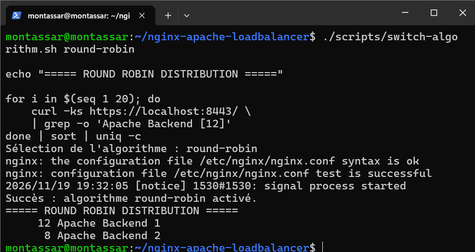
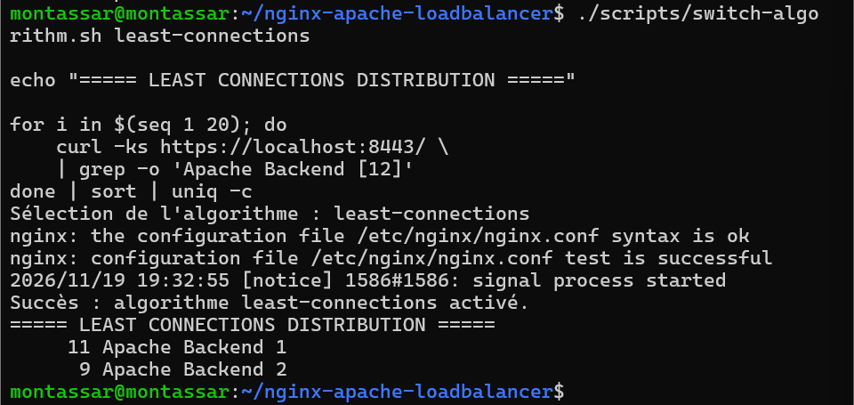
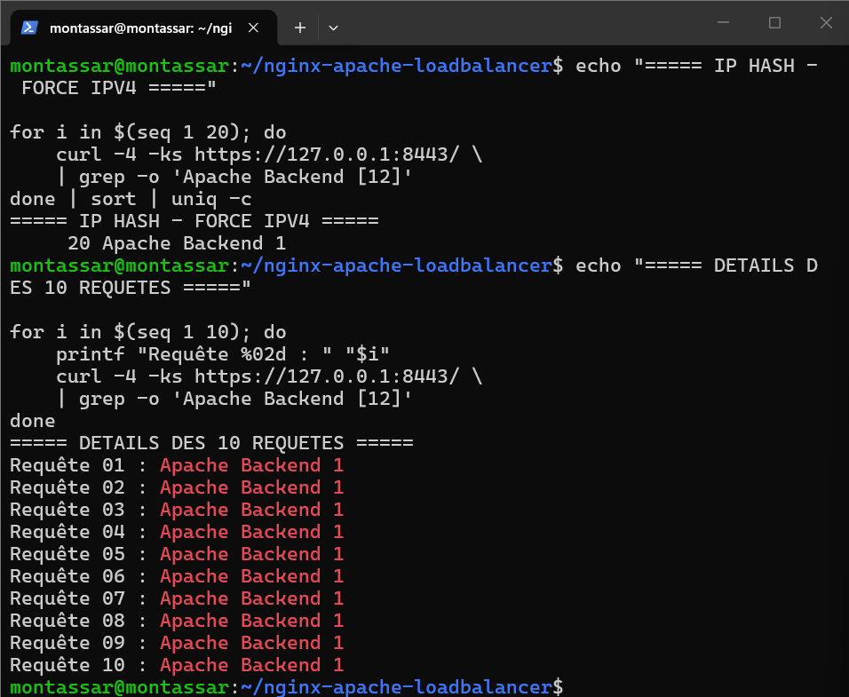
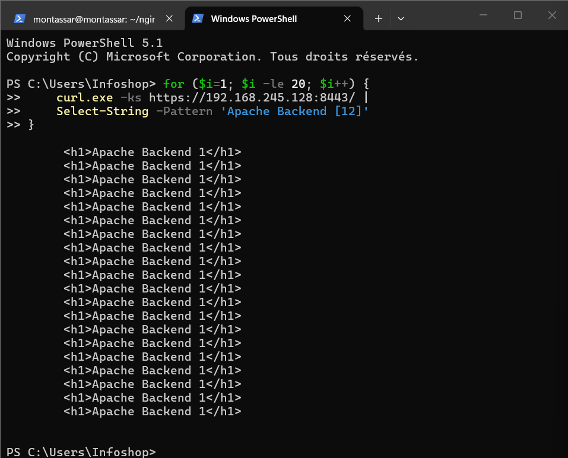
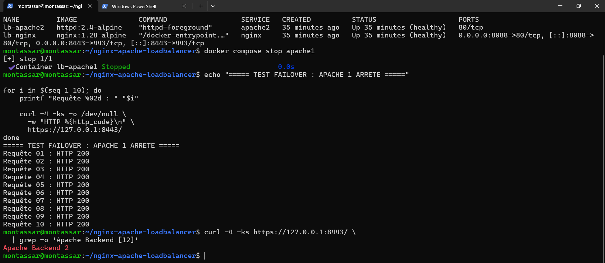
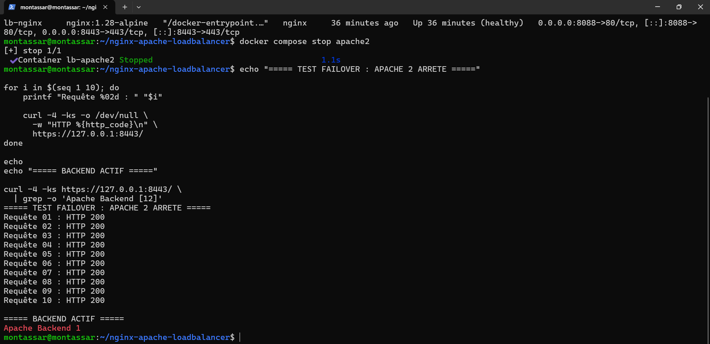

# Docker Nginx Load Balancer

A containerized web infrastructure using **Nginx as an HTTPS reverse proxy and load balancer**, distributing incoming traffic between two Apache backend servers.

The project demonstrates load balancing algorithms, HTTPS configuration, Docker healthchecks, and passive backend failover.

## Architecture

```text
                         Client
                           |
                     HTTP :8088
                           |
                     HTTPS :8443
                           |
                    Nginx Reverse Proxy
                           |
                    Load Balancing Layer
                      /           \
                     /             \
              Apache Backend 1   Apache Backend 2
                  HTTP :80           HTTP :80
```

All three services communicate through an internal Docker network.

### Docker Infrastructure



## Features

- Nginx reverse proxy.
- HTTPS with TLS 1.2 and TLS 1.3.
- Automatic HTTP to HTTPS redirection.
- Two Apache backend servers.
- Three load balancing algorithms:
  - Round Robin
  - Least Connections
  - IP Hash
- Passive backend failure handling.
- Docker healthchecks.
- Docker Compose orchestration.
- Bash script for switching algorithms.
- HTTPS health endpoint.

## Technologies

| Technology | Role |
|---|---|
| Docker Engine | Containerization |
| Docker Compose | Service orchestration |
| Nginx | Reverse proxy and load balancing |
| Apache HTTP Server | Backend web servers |
| OpenSSL | TLS certificate generation |
| ApacheBench | Load testing |
| Bash | Algorithm switching automation |
| Linux | Host environment |

## Project Structure

```text
nginx-apache-loadbalancer/
├── apache/
│   ├── apache1/
│   └── apache2/
├── nginx/
│   ├── conf.d/
│   ├── ssl/
│   ├── nginx.conf
│   ├── round-robin.conf
│   ├── least-connections.conf
│   └── ip-hash.conf
├── scripts/
│   └── switch-algorithm.sh
├── docs/
│   ├── healthchecks.md
│   ├── algorithm-tests.md
│   └── tests/
├── screenshots/
├── docker-compose.yml
├── .gitignore
└── README.md
```

## Requirements

- Linux host or virtual machine.
- Docker Engine.
- Docker Compose plugin.
- OpenSSL.
- curl.
- ApacheBench (optional, for load testing).

## Installation

### 1. Clone the repository

```bash
git clone https://github.com/MontassarHannachi/nginx-apache-loadbalancer.git
cd nginx-apache-loadbalancer
```

### 2. Generate a self-signed TLS certificate

```bash
mkdir -p nginx/ssl

openssl req -x509 -nodes -days 365 \
  -newkey rsa:2048 \
  -keyout nginx/ssl/server.key \
  -out nginx/ssl/server.crt \
  -subj "/C=TN/ST=Tozeur/O=Lab/CN=localhost" \
  -addext "subjectAltName=DNS:localhost,IP:127.0.0.1,IP:192.168.245.128,IP:192.168.213.129"
```

The IP addresses in the certificate must match the addresses used to access the VM. Adjust them if your network configuration changes.

### 3. Start the infrastructure

```bash
docker compose up -d
```

### 4. Check container status

```bash
docker compose ps
```

All three containers should reach the `healthy` state.

## Access

| Service | URL |
|---|---|
| HTTP | http://localhost:8088 |
| HTTPS | https://localhost:8443 |
| Health endpoint | https://localhost:8443/health |

From another machine on the network, replace `localhost` with the VM IP address, for example:

`https://192.168.245.128:8443`

The TLS certificate is self-signed. Use `-k` with curl for laboratory testing. Browsers may display a security warning until the certificate is explicitly trusted.

### HTTPS Access



### HTTP to HTTPS Redirection



## Load Balancing Algorithms

The project supports three Nginx load balancing algorithms. The active configuration is stored in `nginx/conf.d/default.conf`.

### 1. Round Robin

Distributes requests sequentially across the available backend servers.

```bash
./scripts/switch-algorithm.sh round-robin
```

### 2. Least Connections

Forwards new requests to the backend with the fewest active connections.

```bash
./scripts/switch-algorithm.sh least-connections
```

### 3. IP Hash

Uses the client's IP address to determine the backend server. Repeated requests from the same client IP are directed to the same backend while the upstream configuration remains unchanged and that backend is available.

```bash
./scripts/switch-algorithm.sh ip-hash
```

The switching script validates the Nginx configuration before reloading the service.

### Algorithm Test Results

The following results were observed during sequential tests of 20 requests:

| Algorithm | Apache Backend 1 | Apache Backend 2 |
|---|---:|---:|
| Round Robin | 12 | 8 |
| Least Connections | 11 | 9 |
| IP Hash (same client) | 20 | 0 |

These results are observations from a limited test, not a performance ranking. In particular, sequential requests do not demonstrate the advantage of Least Connections under concurrent workloads.

For IP Hash, the test confirms that repeated requests from the same client were mapped to the same backend. It does not guarantee that different clients will be distributed evenly.

### Round Robin Test



### Least Connections Test



### IP Hash Test



### IP Hash Test from Windows



## Backend Failover Tests

The project uses passive failure handling to allow Nginx to forward requests to the remaining available backend when one backend becomes unavailable.

Two scenarios were tested:

- Apache Backend 1 stopped: requests continued to receive HTTP 200 responses from Apache Backend 2.
- Apache Backend 2 stopped: requests continued to receive HTTP 200 responses from Apache Backend 1.

Both backend services were subsequently restarted and returned to a healthy state.

### Apache Backend 1 Failure



### Apache Backend 2 Failure



**Availability limitation:** this demonstrates backend failover, not complete high availability. Nginx is still a single point of failure in this architecture.

## Testing

### Test HTTPS

```bash
curl -k -I https://localhost:8443/
```

### Test HTTP Redirection

```bash
curl -I http://localhost:8088/
```

### Test Health Endpoint

```bash
curl -k https://localhost:8443/health
```

### Load Testing with ApacheBench

```bash
ab -k -n 1000 -c 50 https://localhost:8443/
```

The load test is intended to observe response time and request handling under concurrent load. Results depend on the host resources and test environment.

## Documentation

- [Healthchecks](docs/healthchecks.md)
- [Algorithm comparison and tests](docs/algorithm-tests.md)
- [Backend failover tests](docs/tests/failover-test.md)

## Security Notes

- TLS certificate and private key are excluded from Git.
- HTTPS uses a self-signed certificate for laboratory purposes.
- Backend services communicate through the internal Docker network.
- The certificate must be replaced with a trusted certificate for production.
- This project is a technical demonstration, not a production-hardened deployment.
- Nginx is currently a single point of failure.

## Author

**Montassar Hannachi**

Docker | Linux | Nginx | Networking | System Administration

GitHub: [MontassarHannachi](https://github.com/MontassarHannachi)
